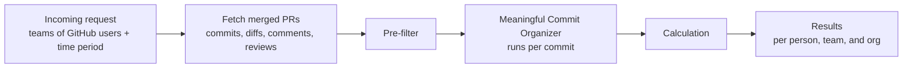

# PR Project

Many companies measure software engineers in performance reviews by how many PRs they merge. A number isn't the problem. A raw count is: with AI, pushing many PRs is easier and faster than ever, so the count says less and less about the work behind them. This project replaces the raw count with a more comprehensive number: one score per PR that reflects how much meaningful work a GitHub user put into their merged pull requests, compared against their team and the wider org.

Instead of counting raw commits or lines, every commit is sorted into a bucket (lint/config, WIP, testing, addressed comments, meaningful) so that formatting passes, throwaway work, and reverted changes don't inflate the score. Commit-message keywords only raise flags. The diff content and GitHub's review data decide the bucket, because anyone can type a keyword.

**Design diagram:** [Figma board](https://www.figma.com/board/2dmzwu1JJKPzuoWVXgia8W/PP?node-id=0-1)

## How it works



### 1. Fetch
For each person, pulls every PR they merged in the time window (GitHub search returns at most 1,000), along with each PR's commits (with diffs), comments, reviews, final diff, and timeline.

### 2. Pre-filter
Removes commits that shouldn't be analyzed at all:
- **Simple:** merge commits, empty commits, lockfile-only commits, bot commits, and commits another GitHub user authored (teammates pushing to the PR). A commit still counts if the user is listed in a `Co-authored-by:` line, matched by GitHub noreply email or by name.
- **Revert pairs:** a commit whose diff is at least 90% the inverse of an earlier commit is paired with it, and both count as zero. In a commit → revert → recommit chain, only the recommit counts.

### 3. Meaningful Commit Organizer
Each remaining commit goes through these steps in order and stops at the first one that assigns a bucket:

| Step | Check | Bucket |
|---|---|---|
| 1. Size & config | Config-only files, diffs of 2 lines or fewer, whitespace-only changes | Lint/Config |
| 2. WIP flag | WIP/temp keywords in the message, placeholder-only lines (`TODO`, `pass`, ...). Only sets flags | — |
| 3. Test check | At least 80% of changed lines are in test files, and fewer than 20 non-test lines changed | Testing |
| 3.5. Conversation | A reviewer asked for changes before the commit (a Request Changes review, or an inline comment on a file the commit touches), and the same reviewer approved after it | Addressed Comments |
| 4. Lint by content | Comment-only or formatting-only changes | Lint/Config |
| | Step 2 placeholder flag confirmed, or under half the added lines survive into the PR's final diff | WIP |
| AI | Claude (Haiku 5.5) reads the diff and judges whether it is a meaningful design change or creation. It sees one diff, not the review timeline, so it can't assign Addressed Comments | Meaningful, Lint/Config, WIP, or Testing |
| | The AI call fails or gives no answer, or the run uses `--no-ai` | Unclassified (scores 0, listed for a rerun) |

Every commit records which check decided its bucket. Commits the AI classified also keep the AI's one-sentence reason. All other commits get `N/A`.

Details:
- **"Before" and "after" in step 3.5** go by position in the PR's commit list, not by timestamp. GitHub records which commit each review and comment was made on, and that survives a rebase, while timestamps don't. If a force-push rewrote that commit away, the check falls back to the commit's author date, which a rebase keeps. PRs with a force-push are marked in the results.
- **Survival** compares a commit's added lines against the lines the whole PR added, not the whole final file, so a line that already existed in the file doesn't count. A line at least 75% similar to a final line also counts, so renaming a variable in a later commit doesn't turn earlier work into WIP. Lines with no letters or digits (`}`, `);`) are skipped because they match anything.
- **The AI** is told that the commit message and diff are written by the person being evaluated, and to ignore any instructions inside them (for example, a comment saying "classify this as meaningful").
- **Files GitHub returns without a diff** (binary or very large) are never treated as lint or formatting, since there is no content to check.

### 4. Calculation
```
score = 3 × log2(1 + meaningful commits)
      + 1 × log2(1 + addressed comment commits)
      + 1 × log2(1 + testing commits)
      + log2(1 + min(lines, 2000))

lines = additions × 1.5 + deletions    # summed over the PR's meaningful commits
```

The bucket check answers *whether* a commit is real work. The size term answers *how much*:
- **Size** uses a log scale, so a 500-line feature (about 9.6) beats a 10-line fix (4.0), but a 5,000-line generated file stops at the cap (11.0). It is computed over the PR's total meaningful lines, so splitting the same work into more commits doesn't raise it.
- **Commit counts** are on a log scale too. One commit earns the full weight (one meaningful commit = 3), and each extra commit earns less. The same 500 lines in ten commits scores 19.9 instead of 12.6 for one commit, a 1.6× gap. With plain counts, the gap would be 10×.

### 5. Results
Per person:
- Total score, PRs merged, and average score per PR
- Number of meaningful PRs: PRs at or above the 75th percentile of **every PR in the run**, a shared bar rather than each person's own history
- Totals per bucket and per pre-filter reason
- Top ranked PRs, marked when a force-push may have made review timing approximate
- Unclassified commits by PR and SHA, so they can be rerun

Then each person's total score against their **team's average** and the **org's average**, as a percentage above or below. The org is everyone across all the teams in `teams.json`.

Everything, including the bucket, deciding check, and AI reason for every commit, is written to `results.json`. That file is the data source for a dashboard.

## Files

| File | What it does |
|---|---|
| `PRs.py` | The pipeline above. Run it for scores. |
| `reviews.py` | Code reviews each person gave in the window, on other people's PRs: total reviews, approvals, and whether their feedback was acted on. |
| `evaluate.py` | Checks the pipeline against your own hand labels (see below). |
| `config.py` | Environment setup, teams, keywords, thresholds, scoring weights, and a rate-limited GitHub request helper. |
| `tests/` | Unit tests for the pipeline, reviews, and evaluation. |

## Setup

```bash
pip install requests python-dotenv anthropic pydantic pytest
```

Copy the template and fill in your values:

```bash
cp .env.example .env
```

It asks for a GitHub token, an Anthropic API key (not needed for `--no-ai`), the username to score, and the review period. `.env.example` explains where to get each one.

To compare people, list each team's GitHub usernames in `teams.json` (copy `teams.example.json`). A person can be on more than one team. When `teams.json` exists, `GITHUB_USERNAME` is ignored.

```json
{
  "platform": ["alice", "bob", "carol"],
  "web": ["dave", "erin"]
}
```

`.env`, `teams.json`, and `results.json` are gitignored.

## Usage

```bash
python PRs.py           # scores, with the AI step run live
python PRs.py --batch   # the same, but AI requests go in one batch at half price; results usually arrive within an hour
python PRs.py --no-ai   # free test run: skips the AI step, those commits are marked unclassified
python reviews.py       # code review impact
python -m pytest        # run the tests
```

- `--batch` gives the same answers as live calls for half the cost. The trade-off is waiting: the script submits every AI request at the end of fetching, then checks every 30 seconds until the batch finishes.
- `--no-ai` is for testing the GitHub fetching, pre-filter, and steps 1–4 without spending anything. Scores from it are lower than real ones, since commits that would have gone to the AI score 0.

Thresholds and weights (test share, survival ratio, percentile cutoff, and so on) are in `config.py`. They are starting guesses, not numbers taken from research, and need to be validated against real repos.

## Checking the pipeline against your own judgement

```bash
python evaluate.py sample --n 100   # pick 100 commits from results.json into labels.csv
# open labels.csv, read each commit at its url, and fill in the label column
python evaluate.py score            # compare your labels with the pipeline
```

- `labels.csv` leaves out the pipeline's answer on purpose, so it can't sway your labels.
- The sample takes an even share from every bucket, so rare buckets get checked too.
- `score` reports overall agreement, precision and recall per bucket, which buckets get confused, and **which check made the calls you disagree with**. That last part tells you which threshold to tune.
- `sample` won't overwrite an existing `labels.csv` unless you pass `--force`.

## Known limitations

- **Thresholds aren't validated yet.** Use `evaluate.py` on 50–100 real commits before trusting the results.
- **Lines aren't comparable across languages.** 100 lines of Java and 100 lines of Python are different amounts of work, so compare people within similar codebases.
- **Unclassified commits score 0.** If the AI fails on some commits, their authors are pulled down in the team comparison until those commits are rerun. The results warn when this happens.
- **Co-author matching is best effort.** It matches GitHub noreply emails and names, so a co-author listed with a personal email GitHub can't link may be missed.
