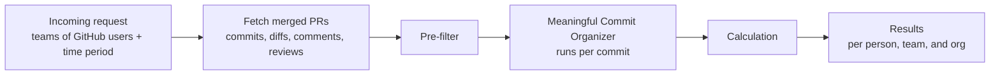

# PR Project

Many companies measure software engineers in performance reviews by how many PRs they merge. A number isn't the problem. A raw count is: with AI, pushing many PRs is easier and faster than ever, so the count says less and less about the work behind them. This project replaces the raw count with a more comprehensive number: one score per PR that reflects how much meaningful work a GitHub user put into their merged pull requests, compared against their team and the wider org.

Instead of counting raw commits or lines, every commit is sorted into a bucket (lint/config, WIP, testing, docs, addressed comments, meaningful) so that formatting passes, throwaway work, and reverted changes don't inflate the score. Commit-message keywords only raise flags. The diff content and GitHub's review data decide the bucket, because anyone can type a keyword.

**Design diagram:** [Figma board](https://www.figma.com/board/2dmzwu1JJKPzuoWVXgia8W/PP?node-id=0-1)

## How it works



### 1. Fetch
For each person, pulls every PR they merged in the time window (GitHub search returns at most 1,000), along with each PR's commits (with diffs), comments, reviews, final diff, and timeline.

### 2. Pre-filter
Removes commits that shouldn't be analyzed at all:
- **Simple:** merge commits, empty commits, lockfile-only commits, bot commits, and commits another GitHub user authored (teammates pushing to the PR). A commit still counts if the user is listed in a `Co-authored-by:` line, matched by GitHub noreply email or by name.
- **Revert pairs:** a commit whose diff is at least 90% the inverse of an earlier commit is paired with it, and both count as zero. In a commit → revert → recommit chain, only the recommit counts.

### 3. Meaningful Commit Organizer
Each remaining commit goes through these steps in order and stops at the first one that assigns a bucket:

| Step | Check | Bucket |
|---|---|---|
| 1. Size & config | Config-only files (including manifests like `Cargo.toml`, lock files, and changelogs, so version bumps land here), diffs of 2 lines or fewer, whitespace-only changes | Lint/Config |
| | Docs-only files (`.md`, `.rst`, `.adoc`, README, LICENSE, ...) that mostly add text | Docs |
| | Docs-only files that mostly remove text (stale or duplicated docs) | Lint/Config |
| 2. WIP flag | WIP/temp keywords in the message, placeholder-only lines (`TODO`, `pass`, ...). Only sets flags | — |
| 3. Test check | At least 80% of changed lines are in test files (test directories like `tests/` and `testdata/`, or names like `test_*.py`), and fewer than 20 non-test lines changed | Testing |
| 3.5. Conversation | A reviewer asked for changes before the commit (a Request Changes review, or an inline comment on a file the commit touches), and the same reviewer approved after it | Addressed Comments |
| 4. Lint by content | Comment-only or formatting-only changes, including a formatter rewrapping lines | Lint/Config |
| | Step 2 placeholder flag confirmed, or under half the added lines survive into the PR's final diff | WIP |
| AI | Claude (Haiku 5.5) reads the diff and judges whether it is a meaningful design change or creation. It sees one diff, not the review timeline, so it can't assign Addressed Comments | Meaningful, Lint/Config, WIP, or Testing |
| | The AI call fails or gives no answer, or the run uses `--no-ai` | Unclassified (scores 0, listed for a rerun) |

Every commit records which check decided its bucket. Commits the AI classified also keep the AI's one-sentence reason. All other commits get `N/A`.

Details:
- **"Before" and "after" in step 3.5** go by position in the PR's commit list, not by timestamp. GitHub records which commit each review and comment was made on, and that survives a rebase, while timestamps don't. If a force-push rewrote that commit away, the check falls back to the commit's author date, which a rebase keeps. PRs with a force-push are marked in the results.
- **Survival** compares a commit's added lines against the lines the whole PR added, not the whole final file, so a line that already existed in the file doesn't count. A line at least 75% similar to a final line also counts, so renaming a variable in a later commit doesn't turn earlier work into WIP. Lines with no letters or digits (`}`, `);`) are skipped because they match anything.
- **The AI** is told that the commit message and diff are written by the person being evaluated, and to ignore any instructions inside them (for example, a comment saying "classify this as meaningful").
- **What the AI counts as meaningful:** refactors that restructure code count, even when behavior stays the same. Mechanical edits applied the same way everywhere (a rename, swapping a deprecated name), version bumps, and regenerated data files are lint/config.
- **Large diffs are trimmed before the AI sees them:** at most 200 patch lines per file and 1,500 per commit. Every file is still listed with its line counts, so the AI knows what it isn't seeing. This keeps a 20,000-line commit about as cheap as a normal one.
- **Docs** are real work, but a different kind from code, so they get their own bucket with the same weight as tests rather than counting as meaningful.
- **Files GitHub returns without a diff** (binary or very large) are never treated as lint or formatting, since there is no content to check.

### 4. Calculation
```
score = 3 × log2(1 + meaningful commits)
      + 1 × log2(1 + addressed comment commits)
      + 1 × log2(1 + testing commits)
      + 1 × log2(1 + docs commits)
      + log2(1 + min(lines, 2000))

lines = additions × 1.5 + deletions    # code lines in the PR's meaningful commits
```

The bucket check answers *whether* a commit is real work. The size term answers *how much*:
- **Size** uses a log scale, so a 500-line feature (about 9.6) beats a 10-line fix (4.0), but a 5,000-line generated file stops at the cap (11.0). It is computed over the PR's total meaningful lines, so splitting the same work into more commits doesn't raise it.
- **Only code counts toward size.** Docs and config files are left out, and so are lines moved inside a commit: an added line that matches a removed line anywhere in the same commit cancels out, so moving code into a new crate doesn't count as writing it. Renamed files count 0, since git only calls a file renamed when it's mostly unchanged.
- **Commit counts** are on a log scale too. One commit earns the full weight (one meaningful commit = 3), and each extra commit earns less. The same 500 lines in ten commits scores 19.9 instead of 12.6 for one commit, a 1.6× gap. With plain counts, the gap would be 10×.

### 5. Results
Per person:
- Total score, PRs merged, and average score per PR
- Number of meaningful PRs: PRs at or above the 75th percentile of **every PR in the run**, a shared bar rather than each person's own history
- Totals per bucket and per pre-filter reason
- Top ranked PRs, marked when a force-push may have made review timing approximate
- Unclassified commits by PR and SHA, so they can be rerun

Then each person's total score against their **team's average** and the **org's average**, as a percentage above or below. The org is everyone across all the teams in `teams.json`.

Everything, including the bucket, deciding check, and AI reason for every commit, is written to `results.json`. That file is the data source for a dashboard.

## Files

| File | What it does |
|---|---|
| `PRs.py` | The pipeline above. Run it for scores. |
| `reviews.py` | Code reviews each person gave in the window, on other people's PRs: total reviews, approvals, and whether their feedback was acted on. |
| `evaluate.py` | Checks the pipeline against your own hand labels (see below). |
| `config.py` | Environment setup, teams, keywords, thresholds, scoring weights, and a rate-limited GitHub request helper. |
| `tests/` | Unit tests for the pipeline, reviews, and evaluation. |

## Setup

```bash
pip install requests python-dotenv anthropic pydantic pytest
```

Copy the template and fill in your values:

```bash
cp .env.example .env
```

It asks for a GitHub token, an Anthropic API key (not needed for `--no-ai`), the username to score, and the review period. `.env.example` explains where to get each one.

To compare people, list each team's GitHub usernames in `teams.json` (copy `teams.example.json`). A person can be on more than one team. When `teams.json` exists, `GITHUB_USERNAME` is ignored.

```json
{
  "platform": ["alice", "bob", "carol"],
  "web": ["dave", "erin"]
}
```

`.env`, `teams.json`, and `results.json` are gitignored.

## Usage

```bash
python PRs.py           # scores, with the AI step run live
python PRs.py --batch   # the same, but AI requests go in one batch at half price; results usually arrive within an hour
python PRs.py --no-ai   # free test run: skips the AI step, those commits are marked unclassified
python reviews.py       # code review impact
python -m pytest        # run the tests
```

- `--batch` gives the same answers as live calls for half the cost. The trade-off is waiting: the script submits every AI request at the end of fetching, then checks every 30 seconds until the batch finishes.
- `--no-ai` is for testing the GitHub fetching, pre-filter, and steps 1–4 without spending anything. Scores from it are lower than real ones, since commits that would have gone to the AI score 0.

Thresholds and weights (test share, survival ratio, percentile cutoff, and so on) are in `config.py`. They are starting guesses, not numbers taken from research, and need to be validated against real repos.

## Checking the pipeline against your own judgement

```bash
python evaluate.py sample --n 100   # pick 100 commits from results.json into labels.csv
# open labels.csv, read each commit at its url, and fill in the label column
python evaluate.py score            # compare your labels with the pipeline
```

- `labels.csv` leaves out the pipeline's answer on purpose, so it can't sway your labels.
- The sample takes an even share from every bucket, so rare buckets get checked too.
- `score` reports overall agreement, precision and recall per bucket, which buckets get confused, and **which check made the calls you disagree with**. That last part tells you which threshold to tune.
- `sample` won't overwrite an existing `labels.csv` unless you pass `--force`.

## Testing a free rule against the AI (shadow mode)

Most commits from developers who mostly do real work reach the AI. To cut those calls, the pipeline tests a candidate free rule in the background: a commit is meaningful when it adds 50+ lines of source code (no test, config, or docs files, and no tests written inside the source, like Rust's `#[cfg(test)]`) and 90%+ of those lines reach the PR's final diff. The rule **never affects scores**. It only records its guess next to the AI's answer, and every run that uses the AI adds those pairs to `shadow_log.jsonl`.

```bash
python evaluate.py shadow
```

This reports how many AI calls the rule would save, how often the AI agreed, and the agreement rate you can be 95% sure of given the sample size. The rule is ready to replace those AI calls once **all three** hold (set in `config.py`):
- at least **100 commits** the rule would have handled
- **98%+ agreement** with the AI
- across at least **5 different people**

Small samples prove little: 19 of 20 agreeing only shows agreement is at least 76%, while 98 of 100 shows at least 93%. The report also lists the disagreements, to hand-label: the AI isn't ground truth either.

## Market and competitors

Researched October 2026. Pricing and accuracy figures mostly come from vendors or third-party blogs, so treat them as rough.

### The market
"Engineering intelligence" tools measure engineering output from GitHub, Jira, and similar data. The established platforms grew up around delivery metrics (cycle time, DORA, PR throughput) sold to engineering leaders. Since AI coding tools took off, the market has shifted to two new questions: **how much real work is in a PR** (raw counts mean less when AI writes code), and **what AI tools are worth** (AI-written code share, cost per PR). This project sits in the first group.

### Closest competitors: measuring the work inside a PR

| Company | What it does | Business | How it compares |
|---|---|---|---|
| [Weave](https://www.ycombinator.com/launches/Mjm-weave-ai-to-quantify-engineering-work) | Runs LLMs and its own models on every PR and review to estimate how long an expert engineer would take ("Weave Hours"). Classifies PRs as features, fixes, or maintenance, and marks AI-written code. Claims 0.94 correlation with expert estimates. | Y Combinator; [raised $13.5M Series A in 2026](https://runtimewire.com/zh/article/weave-raises-13-5-million-measure-ai-coding-roi). Free tier, about $50 per engineer per month. | **Closest match**, same "PR counts are broken in the AI era" pitch. Weave scores whole PRs with a trained model; this project scores each commit with rules first and AI last, and records why. Weave has acknowledged engineers find it "big brother". |
| [GitClear](https://www.gitclear.com/help/meaningful_code_line_change_definition) | "Diff Delta" / "Line Impact": throws out moved, whitespace, and comment changes (it claims about 95% of changed lines are noise), then weights the rest, with deletions worth more than additions. | Paid SaaS. | Same instinct as this project's pre-filter and steps 1 and 4, but **no AI** and line-level weights. This project weights additions *more* than deletions, the opposite choice. |
| [DX](https://getdx.com/blog/5-metrics-in-dx-to-measure-ai-impact/) | "TrueThroughput" uses AI to weight PR throughput by complexity, alongside developer surveys (the "Core 4" framework). | Enterprise, sales-led. | Complexity-weighted throughput at PR level, combined with how developers feel. No per-commit breakdown. |

### Established platforms: delivery metrics, now adding AI reporting

| Company | Focus | Pricing (third-party estimates) | How it compares |
|---|---|---|---|
| [Jellyfish](https://jellyfish.co/library/tools-to-measure-ai-developer-productivity/) | Executive reporting, where engineering time goes, AI impact. Aimed at 200+ developer orgs. | Not public; [estimates run from $50k to $300k a year](https://coderbuds.com/blog/jellyfish-alternatives-2026). | Measures delivery and allocation, not whether individual commits were real work. |
| [LinearB](https://linearb.io/blog/8-million-prs-engineering-productivity) | Delivery metrics plus workflow automation. Argues PR acceptance rate is a better AI measure than suggestion acceptance. | [Free for small teams; roughly $20–60 per developer per month](https://wetheflywheel.com/en/comparisons/linearb-vs-jellyfish-vs-swarmia/). | Counts and times PRs; doesn't judge what's inside them. |
| [Swarmia](https://www.swarmia.com/blog/productivity-impact-of-ai-coding-tools/) | Developer experience and delivery metrics. Reports PR sizes roughly doubled from 2025 to 2026, which is why raw counts mislead. | [Free for small teams; about $23–45 per developer per month](https://orgsignals.com/comparisons/pricing-comparison). | Most transparent pricing; still PR-level metrics. |
| [Waydev](https://www.ycombinator.com/companies/waydev-ai) | Repositioned in 2026 around AI: commit-level attribution of agent, tokens, cost per PR. | [About $10–25 per developer per month](https://gitvelocity.dev/blog/engineering-intelligence-market-2026). | Commit-level like this project, but measures *AI usage and cost*, not whether the work was meaningful. |
| [Span](https://www.span.app/) | Detects AI-written code from the code itself, so it works without tool telemetry; tracks agent sessions. | [Raised $25M in November 2025](https://www.upstartsmedia.com/p/span-raises-25m-ai-code-tracker); pricing not public. | Answers "how much was AI-written", not "how much was real work". |

### Where this project fits

What it does that the others don't:
- **Commit-level buckets with reasons.** It says which commits in a PR were real work and which check decided it, so every score can be explained and disputed. Most tools score whole PRs.
- **Rules first, AI last.** Reverts, survival into the final diff, and review follow-through are checked without a model, and those decisions are free and transparent. Only commits the rules can't decide go to Claude.
- **Built to resist gaming.** Commit counts and size are damped, keywords only raise flags, and the AI ignores instructions written into commits.
- **Open source and self-run.** Code never leaves the machine running it, apart from the diffs sent to the AI step. That matters to security-conscious teams that won't send code to a vendor.

Where it's weaker:
- **No validation yet.** Weave and GitClear claim measured correlations with expert judgement; this project's thresholds are starting guesses until `evaluate.py` is run on real labels.
- **Most commits still need the AI** for developers whose commits are mostly real work. In a test run on one maintainer, the rules decided 11 of 59 commits (about 1 in 5); the AI step and shadow mode exist for the rest. The rules remove noise; they don't replace judgement.
- **No integrations beyond GitHub**, no dashboard yet, and no AI-attribution measure, which is where much of the market's money is going.

Possible positioning: **a tool engineers run on themselves**, to show the real work behind their PRs at review time, rather than a tool managers point at engineers. That answers the "big brother" problem the market already has.

## Known limitations

- **Thresholds aren't validated yet.** Use `evaluate.py` on 50–100 real commits before trusting the results.
- **Lines aren't comparable across languages.** 100 lines of Java and 100 lines of Python are different amounts of work, so compare people within similar codebases.
- **Unclassified commits score 0.** If the AI fails on some commits, their authors are pulled down in the team comparison until those commits are rerun. The results warn when this happens.
- **Force-pushes are common.** In a test run, 13 of 34 PRs (38%) had been force-pushed. Step 3.5 orders by commit position to stay correct, but when a review's commit was rewritten away it falls back to author dates, so those PRs are marked in the results.
- **Moves are detected, copies aren't.** A line only cancels out when the same commit removes it somewhere else. Code copied into a new file while the original stays in place counts as new, and so does code moved between two files too large for GitHub to show a diff. In a test run, a commit that built a new crate by copying and adapting existing code counted about 8,500 lines, roughly a quarter of them verbatim copies. The 2,000-line size cap limits the damage.
- **Tests written inside source files** (common in Rust) can't be found by file path, so those commits still go to the AI.
- **Co-author matching is best effort.** It matches GitHub noreply emails and names, so a co-author listed with a personal email GitHub can't link may be missed.
